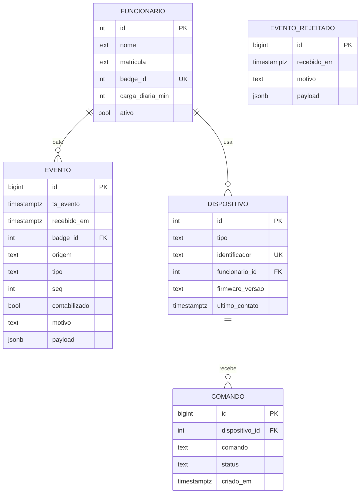

# Banco de dados — Crachá Inteligente de Ponto (Projeto IoT UNIFESP)

> **Para o Claude Code:** este arquivo é a especificação do banco de dados do projeto. Use-o como fonte da verdade para criar os arquivos SQL, o `docker-compose.yml` e os testes descritos abaixo. A equipe é formada por alunos aprendendo IoT e banco de dados: **explique cada passo de forma didática**, escreva comentários em português nos arquivos SQL e mostre como testar cada parte antes de seguir para a próxima. Não mude o modelo de dados sem perguntar antes.

---

## 1. Contexto em 1 minuto

O sistema substitui o relógio de ponto. Um **crachá** (placa Heltec WiFi LoRa 32 V3) bate o ponto de dois jeitos:

| Origem | Como acontece | Caminho até o banco |
| --- | --- | --- |
| `botao` | Funcionário aperta o botão do crachá, em qualquer lugar do prédio | Crachá → LoRa 915 MHz → gateway (2ª Heltec) → Wi-Fi/MQTT → Node-RED → PostgreSQL |
| `ble` | O computador detecta o crachá por Bluetooth (BLE) quando ele chega perto ou se afasta (**não usada no fluxo final**, ver nota abaixo) | Crachá → BLE → agente Python no PC → Wi-Fi/MQTT → Node-RED → PostgreSQL |

> **Atualização de 12/11/2026 (modelo de dados inalterado):** no fluxo final o BLE **não registra ponto**. O botão do
> crachá registra o ponto (LoRa) e também desbloqueia o PC (BLE); o agente do PC só libera e bloqueia a tela.
> Motivo: se `AUSENTE` virasse SAÍDA, todo bloqueio por distância (ex.: ir ao banheiro) registraria uma saída.
> A origem `ble`, a regra R3 para `ble` e os testes T4/E2/E3 **continuam válidos e implementados**, apenas sem uso
> pelo agente. O PC publica só `unifesp/ponto/pc/{badge}/status` (renova `ultimo_contato`). Ver `docs/FLUXO_BLE_E_BLOQUEIO.md`.

O **Node-RED** recebe as mensagens MQTT do tópico `unifesp/ponto/evento` e chama o banco. O banco **guarda o histórico** e **calcula as horas trabalhadas**, que aparecem no painel de gerência do Node-RED.

O banco é também um **desafio extra** da disciplina ("Implementação de banco de dados para histórico", +1 ponto). Para ganhar o ponto, ele precisa funcionar de forma confiável na demonstração: reiniciar o servidor e os dados continuarem lá.

---

## 2. Decisões técnicas

| Decisão | Escolha | Por quê |
| --- | --- | --- |
| Banco | **PostgreSQL** (versão que o Supabase oferece, 15 ou superior) | Escolha da equipe. Banco relacional robusto, com bons tipos de data/hora e funções de janela (`LEAD()`, `LAG()`) que facilitam calcular a jornada. Tudo o que este documento usa existe nas versões 15, 16 e 17 |
| Onde roda | **Supabase** (PostgreSQL gerenciado na nuvem), projeto `ponto-unifesp`, região São Paulo | **Decisão de 03/11/2026:** o notebook da equipe não permite instalar Docker (sem acesso de administrador). O Supabase dá um PostgreSQL pronto, sem instalar nada. O Docker fica opcional, só para Mosquitto e Node-RED, se for possível |
| Quem acessa | **Node-RED**, pelo nó `node-red-contrib-postgresql`, conectando no **Session pooler** do Supabase | É a etapa de nuvem obrigatória da disciplina. A conexão direta do plano gratuito usa IPv6 e costuma falhar em hotspot de celular |
| Fuso horário | Datas gravadas como `TIMESTAMPTZ` (com fuso); "dia" calculado em `America/Sao_Paulo` | Evita que um ponto às 22h vire "dia seguinte" por causa do UTC. O Supabase roda em UTC, então **toda conversão de dia deve usar `AT TIME ZONE 'America/Sao_Paulo'` de forma explícita**, sem depender da configuração do servidor |
| Onde fica a regra de negócio | **No banco**, numa função `registrar_ponto()` | A regra fica num lugar só, pode ser testada com SQL puro e o Node-RED só faz uma chamada |
| Jornada | **Views** (consultas salvas), não tabelas | Sempre calculada a partir dos eventos, então nunca fica desatualizada |

---

## 3. Dados que chegam (payloads MQTT)

O Node-RED recebe JSON no tópico `unifesp/ponto/evento`. São dois formatos.

**Ponto pelo botão** (publicado pelo gateway):

```json
{"ts":"2026-11-10T08:02:15-03:00","badge":101,"origem":"botao","seq":42,"fila":false,"rssi_lora":-71,"snr":9.5}
```

**Ponto automático por BLE** (publicado pelo agente do PC):

```json
{"ts":"2026-11-10T08:05:40-03:00","badge":101,"origem":"ble","seq":7,"estado":"PRESENTE","rssi_ble":-58}
```

| Campo | Significado |
| --- | --- |
| `ts` | Hora do evento. No botão vem do relógio DS1302 do crachá; no BLE vem do PC |
| `badge` | ID do crachá (= funcionário) |
| `origem` | `botao` ou `ble` |
| `seq` | Contador que cresce a cada mensagem daquela origem; serve para descartar retransmissões |
| `fila` | `true` se o ponto foi batido fora do alcance do gateway e enviado depois |
| `estado` | Só no BLE: `PRESENTE` (chegou perto do PC) ou `AUSENTE` (se afastou) |
| `rssi_lora`, `snr`, `rssi_ble` | Qualidade do sinal; útil para diagnóstico e para mostrar no painel |

Outros tópicos que atualizam o banco:

| Tópico | Efeito no banco |
| --- | --- |
| `unifesp/ponto/gateway/status` | Atualiza `ultimo_contato` do gateway na tabela `dispositivo` |
| `unifesp/ponto/pc/{badge}/status` | Atualiza `ultimo_contato` do PC na tabela `dispositivo` |

---

## 4. Modelo de dados

### 4.1 Visão geral (diagrama entidade-relacionamento)



Como ler: um funcionário bate **muitos** eventos; um funcionário pode ter **vários** dispositivos (crachá, PC); um dispositivo recebe **vários** comandos. `EVENTO_REJEITADO` fica isolada de propósito: guarda o que chegou com problema sem "sujar" a tabela principal.

### 4.2 Tabelas

#### `funcionario`: quem trabalha na empresa

| Coluna | Tipo | Regra | Explicação |
| --- | --- | --- | --- |
| `id` | `SERIAL` | PK | Número interno gerado pelo banco |
| `nome` | `TEXT` | obrigatório | |
| `matricula` | `TEXT` | único | Identificação usada pela empresa |
| `badge_id` | `INTEGER` | único, obrigatório | ID gravado no firmware do crachá |
| `carga_diaria_min` | `INTEGER` | obrigatório, padrão 480, > 0 | Carga horária diária em minutos (480 = 8 h) |
| `ativo` | `BOOLEAN` | padrão `true` | Funcionário desligado continua no histórico, mas não bate mais ponto |
| `criado_em` | `TIMESTAMPTZ` | padrão `now()` | |

#### `evento`: todo ponto aceito (o histórico)

| Coluna | Tipo | Regra | Explicação |
| --- | --- | --- | --- |
| `id` | `BIGSERIAL` | PK | `BIGSERIAL` porque o histórico cresce sem parar |
| `ts_evento` | `TIMESTAMPTZ` | obrigatório | Quando o ponto foi batido (hora usada nos cálculos) |
| `recebido_em` | `TIMESTAMPTZ` | padrão `now()` | Quando chegou ao servidor. A diferença mostra atraso ou fila |
| `badge_id` | `INTEGER` | FK → `funcionario.badge_id` | |
| `origem` | `TEXT` | `botao` ou `ble` | |
| `tipo` | `TEXT` | `CHEGADA` ou `SAIDA` | Decidido pela função `registrar_ponto()` (regra R3) |
| `seq` | `INTEGER` | obrigatório | |
| `fila` | `BOOLEAN` | padrão `false` | |
| `rssi` | `SMALLINT` | opcional | RSSI LoRa (botão) ou BLE (PC) |
| `snr` | `REAL` | opcional | Só LoRa |
| `contabilizado` | `BOOLEAN` | padrão `true` | `false` = fica no histórico, mas não conta horas (regra R4) |
| `motivo` | `TEXT` | opcional | Por que não foi contabilizado, ou observação (ex.: `HORA_CORRIGIDA`) |
| `payload` | `JSONB` | opcional | Mensagem original completa, para auditoria e depuração |

**Restrição única:** `UNIQUE (badge_id, origem, seq)`. Se o mesmo pacote chegar duas vezes (retransmissão LoRa), o banco recusa o segundo.

**Índice:** `(badge_id, ts_evento)`, porque quase toda consulta filtra por funcionário e período.

#### `evento_rejeitado`: o que chegou com problema

| Coluna | Tipo | Explicação |
| --- | --- | --- |
| `id` | `BIGSERIAL` PK | |
| `recebido_em` | `TIMESTAMPTZ` padrão `now()` | |
| `motivo` | `TEXT` | `CRACHA_DESCONHECIDO`, `FUNCIONARIO_INATIVO`, `PAYLOAD_INVALIDO` |
| `payload` | `JSONB` | Mensagem original |

**Por que uma tabela separada?** Um crachá desconhecido não pode entrar em `evento`, porque a FK exige um funcionário. Mesmo assim, queremos saber que alguém tentou bater ponto com ele.

#### `dispositivo`: crachás, gateway e PCs

| Coluna | Tipo | Regra | Explicação |
| --- | --- | --- | --- |
| `id` | `SERIAL` | PK | |
| `tipo` | `TEXT` | `cracha`, `gateway` ou `pc` | |
| `identificador` | `TEXT` | único | `badge_id` para crachá; nome ou MAC para gateway/PC |
| `funcionario_id` | `INTEGER` | FK opcional | Dono do crachá ou do PC; vazio no gateway |
| `descricao` | `TEXT` | opcional | Ex.: "Gateway do laboratório 3" |
| `firmware_versao` | `TEXT` | opcional | Mostrada no painel; prova do desafio de OTA |
| `ultimo_contato` | `TIMESTAMPTZ` | opcional | Atualizada a cada mensagem; o painel mostra "online" se < 2 min |

#### `comando`: ordens enviadas pelo painel (apoio ao desafio de OTA)

| Coluna | Tipo | Regra | Explicação |
| --- | --- | --- | --- |
| `id` | `BIGSERIAL` | PK | |
| `dispositivo_id` | `INTEGER` | FK | |
| `comando` | `TEXT` | `OTA` ou `BIPE` | `BIPE` serve para testar a comunicação de volta |
| `parametros` | `JSONB` | opcional | Ex.: `{"url":"http://.../cracha_v2.bin","versao":"2.0"}` |
| `status` | `TEXT` | `PENDENTE`, `ENVIADO`, `CONFIRMADO`, `FALHOU` | |
| `criado_em`, `enviado_em`, `confirmado_em` | `TIMESTAMPTZ` | | Linha do tempo do comando |

---

## 5. Regras de negócio

Todas as regras ficam na função `registrar_ponto()`, exceto R6 e R7, que ficam nas views.

| ID | Regra |
| --- | --- |
| **R1. Crachá válido** | Se o `badge_id` não existe em `funcionario` → grava em `evento_rejeitado` com motivo `CRACHA_DESCONHECIDO`. Se existe mas `ativo = false` → motivo `FUNCIONARIO_INATIVO`. Nada entra em `evento`. |
| **R2. Sem duplicatas** | Se já existe evento com o mesmo `(badge_id, origem, seq)` → não grava de novo e retorna o evento existente com motivo `DUPLICADO`. Usar `INSERT ... ON CONFLICT DO NOTHING`. |
| **R3. Chegada ou saída** | Origem `ble`: `PRESENTE` = `CHEGADA`, `AUSENTE` = `SAIDA`. Origem `botao`: o crachá não sabe se é entrada ou saída, então o banco **alterna**. Se o último evento contabilizado do funcionário **no mesmo dia** (em `America/Sao_Paulo`) e **com `ts_evento` anterior** foi `CHEGADA`, o novo é `SAIDA`; caso contrário (inclusive primeiro do dia), é `CHEGADA`. |
| **R4. Alternância obrigatória** | Eventos contabilizados de um funcionário num dia sempre alternam CHEGADA → SAIDA → CHEGADA… Se o novo evento tem o **mesmo tipo** do último contabilizado do dia, ele é gravado com `contabilizado = false` e motivo `MESMO_TIPO_DO_ANTERIOR`. Exemplo: bateu o botão na entrada (CHEGADA) e depois chegou ao PC (BLE PRESENTE = CHEGADA): o segundo fica no histórico, mas não conta horas. Esta regra substitui a "regra dos 30 minutos" citada no documento do projeto. |
| **R5. Hora confiável** | Se `ts_evento` está mais de 5 min no futuro ou mais de 24 h no passado em relação a `recebido_em` (relógio do crachá desregulado), usar `recebido_em` como `ts_evento` e gravar motivo `HORA_CORRIGIDA` (o evento continua contabilizado). |
| **R6. Jornada do dia** | Minutos trabalhados = soma dos intervalos entre cada CHEGADA e a SAIDA seguinte, só com eventos contabilizados. Uma CHEGADA sem SAIDA conta até `now()` **se o dia for hoje**; em dias anteriores, não conta (aparece como "saída não registrada"). Saldo = minutos trabalhados − `carga_diaria_min`. |
| **R7. Presença atual** | Funcionário está presente se o último evento contabilizado de hoje é `CHEGADA`. |
| **R8. Contato do dispositivo** | Toda mensagem recebida atualiza `dispositivo.ultimo_contato` do crachá (e do PC, quando a origem é `ble`). |

**Limitações aceitas (fora do escopo acadêmico):** jornada que atravessa a meia-noite não é tratada; um evento de fila que chega muito atrasado e "no meio" de outros não recalcula o tipo dos eventos posteriores. Citar isso na documentação mostra maturidade ao professor.

---

## 6. Função principal: `registrar_ponto()`

É a **única porta de entrada** dos pontos. O Node-RED chama só ela.

**Assinatura proposta:**

```sql
registrar_ponto(
  p_badge_id  INTEGER,
  p_origem    TEXT,               -- 'botao' | 'ble'
  p_seq       INTEGER,
  p_ts        TIMESTAMPTZ,
  p_estado    TEXT     DEFAULT NULL,  -- só BLE: 'PRESENTE' | 'AUSENTE'
  p_rssi      SMALLINT DEFAULT NULL,
  p_snr       REAL     DEFAULT NULL,
  p_fila      BOOLEAN  DEFAULT false,
  p_payload   JSONB    DEFAULT NULL
)
RETURNS TABLE (evento_id BIGINT, tipo TEXT, contabilizado BOOLEAN, motivo TEXT)
```

**Passo a passo interno**, na ordem:

1. Valida o crachá (R1). Se rejeitado, grava em `evento_rejeitado` e retorna `evento_id = NULL` com o motivo.
2. Verifica duplicata (R2).
3. Corrige a hora se necessário (R5).
4. Decide o tipo (R3).
5. Decide se é contabilizado (R4).
6. Grava em `evento`.
7. Atualiza `dispositivo.ultimo_contato` (R8).
8. Retorna o resultado. O Node-RED usa esse retorno para atualizar o painel e para registrar no log.

Escrever em **PL/pgSQL**, com um comentário explicando cada bloco.

---

## 7. Views para o painel

Uma view é uma consulta SQL salva com nome. O Node-RED faz `SELECT * FROM vw_...` como se fosse uma tabela, mas o resultado é sempre calculado na hora.

| View | Colunas | Usada no painel para |
| --- | --- | --- |
| `vw_presenca_atual` | funcionario_id, nome, presente (bool), desde (hora do último evento), origem | Quadro "Presentes agora" |
| `vw_jornada_diaria` | funcionario_id, nome, dia, primeira_chegada, ultima_saida, minutos_trabalhados, carga_diaria_min, saldo_min, saida_pendente (bool) | Tabela de horas do dia e histórico |
| `vw_jornada_semanal` | funcionario_id, nome, semana (segunda-feira da semana), minutos_trabalhados, carga_semanal_min, saldo_min | Gráfico de horas da semana |
| `vw_historico` | evento + nome do funcionário, `ts_evento` já convertido para `America/Sao_Paulo` | Tabela de histórico e exportação CSV |
| `vw_dispositivos` | dispositivo + `online` (`ultimo_contato` < 2 min) | Status do gateway, crachá e PC |

**Dica para a `vw_jornada_diaria`:** usar `LEAD(tipo) OVER (PARTITION BY badge_id, dia ORDER BY ts_evento)` para "olhar" o evento seguinte e formar os pares CHEGADA → SAIDA. É a técnica de função de janela citada no documento do projeto.

---

## 8. Segurança básica

- Criar um usuário de banco **`nodered`** só com o necessário: `EXECUTE` em `registrar_ponto()`, `SELECT` nas views, `INSERT`/`UPDATE` em `comando` e `UPDATE` em `dispositivo.ultimo_contato`. O Node-RED **não** usa o superusuário `postgres`.
- Senhas no arquivo `.env`, que fica no `.gitignore`. No Git vai só um `.env.example`. A senha do banco e a string de conexão do Supabase **nunca** vão para o Git nem para prints da apresentação.
- **Por quê:** se alguém descobrir a senha do Node-RED, ainda assim não consegue apagar tabelas. É o princípio do "menor privilégio", fácil de explicar na arguição.

**Cuidados específicos do Supabase** (o Supabase expõe o schema `public` por uma API REST pública, o que o Docker local não fazia):

- Em `01_schema.sql`, ativar **RLS** em todas as tabelas: `ALTER TABLE ... ENABLE ROW LEVEL SECURITY;`. Sem nenhuma política criada, a API pública não enxerga nada.
- Em `04_usuarios.sql`, tirar as permissões dos papéis da API: `REVOKE ALL ON ALL TABLES IN SCHEMA public FROM anon, authenticated;` (o mesmo para funções e sequências).
- Declarar `registrar_ponto()` como `SECURITY DEFINER` com `SET search_path = public`, para o `nodered` poder executá-la sem ter acesso direto às tabelas.
- O `nodered` conecta pelo pooler com o usuário no formato `nodered.<ref-do-projeto>` (o `<ref-do-projeto>` aparece na string de conexão do painel). SSL é obrigatório.
- A **service_role key** e a **anon key** do Supabase não são usadas neste projeto. Nunca colocar no Node-RED nem no Git.

---

## 9. Infraestrutura (Docker)

> **Mudança de 03/11/2026:** o banco roda no **Supabase**, não em container. O Docker não pode ser instalado nos notebooks da equipe (sem acesso de administrador).

### 9.1 Banco no Supabase

- Projeto `ponto-unifesp`, região **South America (São Paulo)**, plano gratuito.
- A senha do banco é definida na criação e aparece uma única vez. Guardar fora do Git.
- Os arquivos de `db/init/` **não rodam sozinhos**. Executar um por vez no **SQL Editor** do painel, na ordem `01` a `05`. Se algum falhar, corrigir e rodar de novo (por isso os scripts devem poder ser repetidos: `CREATE ... IF NOT EXISTS`, `CREATE OR REPLACE`).
- Opcional: `psql` ou DBeaver no notebook, usando a string de conexão do Supabase.
- Como começar do zero durante o desenvolvimento: um script `db/reset.sql` com `DROP SCHEMA public CASCADE; CREATE SCHEMA public;` (usar com cuidado, apaga tudo).
- **Fuso:** opcionalmente `ALTER DATABASE postgres SET timezone TO 'America/Sao_Paulo';`, mas o código não deve depender disso (ver seção 2).

### 9.2 Conexão do Node-RED

Instalar a paleta `node-red-contrib-postgresql` e configurar com os dados do **Session pooler** (painel Supabase, botão **Connect**):

| Campo | Valor |
| --- | --- |
| Host | `aws-0-us-east-1.pooler.supabase.com` (o do projeto `ponto-unifesp`; sempre conferir no painel) |
| Porta | `5432` (Session pooler) |
| Banco | `postgres` |
| Usuário | `nodered.<ref-do-projeto>` |
| SSL | ligado |

### 9.3 Limitações do plano gratuito (citar na documentação)

- **O projeto pausa após cerca de 1 semana sem uso.** Entrar no painel e reativar antes dos ensaios e da apresentação (04/12).
- **A demonstração precisa de internet.** Usar o hotspot do celular em 2,4 GHz, como já previsto no projeto. Se a internet cair, o Node-RED não grava (ver risco abaixo).
- Backups automáticos não fazem parte do plano gratuito. Antes da apresentação, exportar um dump ou um CSV do histórico como garantia.

### 9.4 Docker (opcional, só para Mosquitto e Node-RED)

Se for possível rodar Docker em alguma máquina da equipe (por exemplo, o notebook de alguém com permissão), o `cloud/docker-compose.yml` serve para Mosquitto e Node-RED. O serviço `postgres` dele **não é usado**. Se ninguém conseguir, rodar o Node-RED com Node.js e o Mosquitto de forma portátil. Isso será decidido no passo 8.

---

## 10. Arquivos a criar

```text
cloud/
├── docker-compose.yml          ← opcional, só Mosquitto e Node-RED (o banco é o Supabase)
├── .env.example                ← modelo das credenciais do Supabase
└── db/
    ├── README.md               ← como criar o projeto no Supabase, rodar os scripts, testar e resetar (passo a passo para iniciantes)
    ├── reset.sql               ← apaga e recria o schema public (só para desenvolvimento)
    ├── init/                   ← rodar no SQL Editor do Supabase, na ordem dos números
    │   ├── 01_schema.sql       ← tabelas, restrições, índices
    │   ├── 02_funcoes.sql      ← registrar_ponto() e funções auxiliares
    │   ├── 03_views.sql        ← views do painel
    │   ├── 04_usuarios.sql     ← usuário nodered e permissões
    │   └── 05_seed.sql         ← dados de exemplo
    └── testes/
        └── testes_regras.sql   ← cenários da seção 12, com o resultado esperado em comentário
```

---

## 11. Dados de exemplo (seed)

| Tabela | Dados |
| --- | --- |
| `funcionario` | Badge 101 (crachá real da demonstração, 480 min); badge 102 (só para testes, 360 min); badge 103 inativo (testar R1) |
| `dispositivo` | Crachá 101; gateway `gw-lab`; PC `pc-lab-01` (Windows 11) do funcionário 101 |
| `evento` | Um dia passado completo para o badge 101 (chegada 08:00, saída 12:00, chegada 13:00, saída 17:30) para o painel já abrir com histórico |

Não usar nomes de pessoas reais no seed; usar "Funcionário Teste 1", "Funcionário Teste 2" etc.

---

## 12. Testes de aceite

Cada cenário vira um bloco em `testes_regras.sql`, que chama `registrar_ponto()` e confere o resultado. Rodar no SQL Editor do Supabase com o banco recém-criado (ou depois de `reset.sql` e dos scripts `01` a `05`).

| # | Cenário | Resultado esperado |
| --- | --- | --- |
| T1 | Botão do badge 101, primeiro do dia | `CHEGADA`, contabilizado |
| T2 | Botão de novo, seq seguinte | `SAIDA`, contabilizado (alternância R3) |
| T3 | Repetir exatamente o T2 (mesmo seq) | Não grava; motivo `DUPLICADO` |
| T4 | Botão (CHEGADA) e, 2 min depois, BLE `PRESENTE` | Segundo evento gravado com `contabilizado = false`, motivo `MESMO_TIPO_DO_ANTERIOR` |
| T5 | Badge 999 (não cadastrado) | Linha em `evento_rejeitado`, motivo `CRACHA_DESCONHECIDO` |
| T6 | Badge 103 (inativo) | Linha em `evento_rejeitado`, motivo `FUNCIONARIO_INATIVO` |
| T7 | `ts` com 3 dias de atraso e `fila = false` | `ts_evento` = hora de recebimento, motivo `HORA_CORRIGIDA` |
| T8 | Chegada 08:00, saída 12:00, chegada 13:00, saída 17:00 | `vw_jornada_diaria`: 480 min, saldo 0 |
| T9 | Chegada hoje sem saída | `vw_presenca_atual`: presente; jornada contando até agora |
| T10 | Persistência: fechar a conexão do Node-RED, reiniciar o Node-RED (e, se der tempo, pausar e restaurar o projeto no painel do Supabase) e consultar `vw_historico` | Todos os dados continuam lá (evidência do desafio extra). Como o banco é externo ao Node-RED, reiniciar o Node-RED ao vivo mostra que o histórico não depende dele |

---

## 13. Integração com o Node-RED (referência)

Fluxo esperado:

```text
[mqtt in: unifesp/ponto/evento] → [json] → [function: monta parâmetros] → [postgresql: SELECT * FROM registrar_ponto($1,...)] → [function: formata] → [dashboard]
```

O nó `function` monta `msg.params` na ordem da assinatura da função, por exemplo:

```javascript
const p = msg.payload;
msg.params = [p.badge, p.origem, p.seq, p.ts, p.estado ?? null,
              p.rssi_lora ?? p.rssi_ble ?? null, p.snr ?? null,
              p.fila ?? false, JSON.stringify(p)];
return msg;
```

Se a conexão com o Supabase falhar (internet fora, projeto pausado), o nó `postgresql` devolve erro. Ligar a saída de erro a um nó `debug` e a um aviso no painel, para a falha não passar despercebida. Pontos perdidos nessa janela não são reenviados pelo MQTT, então verificar a conexão antes da demonstração.

**Por que parâmetros (`$1`, `$2`…) e não montar o SQL com texto?** Montar SQL juntando strings permite *SQL injection*: um payload malicioso poderia virar um comando no banco. Com parâmetros, o banco trata cada valor como dado, nunca como comando.

---

## 14. Ordem sugerida de trabalho (para o Claude Code)

1. Criar o projeto no Supabase (região São Paulo) e rodar `SELECT version(), now();` no SQL Editor, explicando o que aconteceu.
2. `01_schema.sql`: criar as tabelas (com RLS ativado) e conferir a estrutura em **Table Editor** ou consultando `information_schema.columns`, para a equipe ver as colunas e restrições.
3. `05_seed.sql` e algumas consultas simples para praticar `SELECT`.
4. `02_funcoes.sql` e testes T1 a T7.
5. `03_views.sql` e testes T8 e T9.
6. `04_usuarios.sql` (incluindo os `REVOKE` dos papéis da API) e verificação de que o usuário `nodered` não consegue `DROP TABLE`.
7. Teste T10 e o `README.md` do banco.
8. Só depois: decidir como rodar Mosquitto e Node-RED (Docker se possível, senão instalação portátil) e ligar o fluxo ao banco pelo Session pooler.

Em cada passo: explicar o conceito novo (chave primária, chave estrangeira, índice, view, função, permissão) em linguagem simples, antes de escrever o código.
